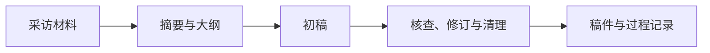

# FeaturePipe

[](https://github.com/LiuJiani0706/FeaturePipe/actions/workflows/test.yml)
[](pyproject.toml)
[](LICENSE)

**从采访材料到中文特稿，保留来源、过程稿与修订记录。**

- **采访写作**：整理材料、生成大纲、撰写初稿，逐句审阅并顺序修订。
- **提示词实验**：比较写作提示词，记录篇幅、模型调用与估算费用。
- **Codex Skill**：由当前助手完成写作，也可配置外部模型执行实验。

## 工作流程



## 快速上手

需要 **Python 3.10+**，无第三方运行依赖。先用内置虚构材料运行离线演示：

```bash
git clone https://github.com/LiuJiani0706/FeaturePipe.git
cd FeaturePipe
python3 skills/featurepipe-reporter/scripts/run.py demo --output runs/demo
```

结果见 `runs/demo/article.md`，过程报告见 `runs/demo/report.json`。演示使用固定响应，不需要密钥、不调用外部 API；输出目录需尚不存在。

要用自己的采访或连接模型，请看[使用指南](docs/USAGE.md)。

## 作为 Codex Skill 使用

将 [`skills/featurepipe-reporter`](skills/featurepipe-reporter) 复制到 `~/.codex/skills/`，然后在 Codex 中输入：

> $featurepipe-reporter 用这份采访写一篇中文特稿，先给大纲，再写正文，保留来源、修订记录和待核实问题。

默认使用当前助手的会话额度；外部 API 为可选项。[安装与使用说明](docs/USAGE.md#使用-codex-skill)。

## 文档

| 文档 | 内容 |
| --- | --- |
| [使用指南](docs/USAGE.md) | 输入格式、DOCX 导入、模型配置、预算、续跑与输出 |
| [方法与复现边界](docs/REPRODUCTION.md) | 论文协议、工程适配及简版差异 |
| [评估记录](docs/EVALUATION.md) | 已有实测、已知问题及评测设计 |
| [中文提示词](prompt_sets/论文提示词中文执行版.txt) | 按阶段整理的中文执行模板 |
| [贡献指南](CONTRIBUTING.md) · [数据与安全](SECURITY.md) | 开发参与、隐私与公开范围 |

## 研究与许可

依据 FeaturePipe 研究方法独立实现。研究署名：**Ruowan Zhu（一作）、Jiani Liu（二作）**。代码采用 [MIT License](LICENSE)。

当前为研究原型，尚未完成完整五轮实验和人工盲评；生成稿仍需核对事实与引语。仓库不包含真实采访或密钥，完整说明见[复现边界](docs/REPRODUCTION.md)与[安全说明](SECURITY.md)。
